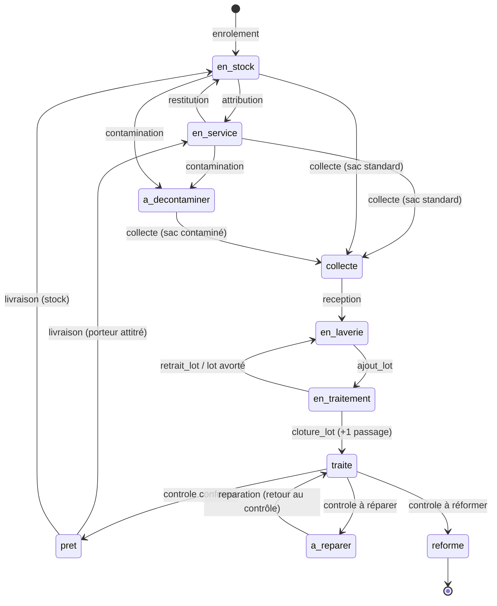
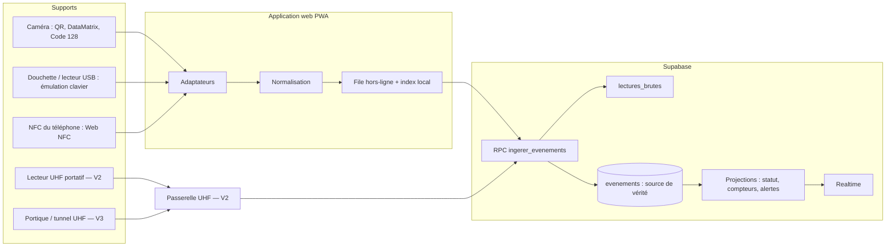

# Traçabilité du linge professionnel — Concept

Version du 23 octobre 2026. Document de référence fonctionnel ; la version vivante et commentable est le doc Claude « Traçabilité du linge professionnel — Concept ».

---

## 1. Vision

Chaque vêtement reçoit une identité numérique unique, indépendante de la technologie de marquage. Chaque passage en laverie devient un événement horodaté : le compteur de passages se déduit de l'historique, il n'est jamais saisi à la main.

**Objectifs**

- Savoir à tout moment où se trouve chaque vêtement, à qui il est attribué et dans quel état.
- Compter les passages de façon fiable, **par type de traitement**, pour respecter la durée de vie fabricant et déclencher contrôle ou réforme.
- Accepter tout support d'identification, combinables sur un même vêtement.
- Réduire les pertes et produire une preuve de conformité exportable.

**Principe fondateur** — le vêtement et son étiquette sont deux objets distincts. Un tag perdu se remplace sans perdre l'historique.

## 2. Décisions de cadrage (23 octobre 2026)

| Question | Décision | Conséquence |
| --- | --- | --- |
| Cible | Multi-clients, d'abord les zones de secours | Vocabulaire pompiers ; une zone = une organisation, ses postes = des sites |
| Laverie | Interne et externe | Portail prestataire en V1 |
| iPhone | Possible | V1 Android ; QR seul sur iPhone ; app iPhone avec NFC en V2 si besoin |
| Existant | Étiquettes et douchettes probables | Reprise en V1 : import CSV, enrôlement au scan d'un tag inconnu |
| Traitements séparés | Oui : lavage, séchage, nettoyage à sec (+ décontamination) | Un compteur et une limite par traitement |
| Limites par article | Saisies à l'encodage | Champs obligatoires, notice jointe, surcharge possible par exemplaire |
| Linge contaminé | Circuit séparé | Statut, sac et lot dédiés, contrôle renforcé |
| Hors-ligne en laverie | Indispensable en V1 | Index local, file de synchro, règles bloquantes vérifiées sur l'appareil |
| Budget matériel | Devis à demander | Aucun prix dans ce document |

**Encore ouvert** : volumes (vêtements, pompiers, passages par semaine) ; zone pilote et sa laverie ; inventaire de l'existant chez la zone pilote ; suivi d'exposition lié au numéro d'intervention (option, avis prévention et DPO requis).

**Décisions provisoires** (24 octobre 2026) — réponses génériques en attendant le terrain, toutes modifiables dans l'app sans développement :

| Question | Choix par défaut | Où le changer |
| --- | --- | --- |
| Circuits des traitements | Lavage et séchage : les deux circuits ; nettoyage à sec : standard ; décontamination : contaminé | *Paramètres → Traitements* |
| Activation d'un article | Notice + au moins une limite de traitement ; option « une limite pour chaque traitement actif » | *Paramètres → Organisation* |
| Identification des sacs de collecte | Un sac est un contenant réutilisable qui porte un ou plusieurs identifiants, comme un vêtement (QR généré par l'app, code-barres ou NFC existant) ; chaque tournée crée un lot `sac_collecte` rattaché à ce sac | Mis en œuvre au jalon M6 |
| Format des étiquettes | Modèles A4 et rouleaux, ou format personnalisé en mm | *Imprimer des étiquettes QR*, réglé par appareil |
| Conflit entre deux appareils hors ligne | La base tranche dans l'ordre d'arrivée : la première action reçue s'applique, la suivante devient un « conflit à résoudre » sur l'appareil qui l'a faite ; jamais de double comptage | Écran *Synchronisation* (réessayer ou classer) |
| Actions possibles hors ligne | Collecte, réception, lots, contrôle, réparation, livraison, contamination, perte, réforme ; annulation, enrôlement et tags demandent une connexion | Mis en œuvre au jalon M7 |
| Index local | Rôles admin, gestionnaire, opérateur laverie, laverie externe ; effacé à la déconnexion | Mis en œuvre au jalon M7 |
| Délais « non revenu » | Collecté sans réception : 2 jours ; en laverie : 7 jours | *Paramètres → Organisation* |
| Usure des tags | Aucune garantie saisie (pas d'alerte) tant que la fiche du fabricant n'est pas connue ; alerte à 80 % de la garantie | *Paramètres → Organisation* |
| Acquittement des alertes | Admin, gestionnaire, opérateur laverie ; une alerte acquittée ne se rouvre pas pour la même cause | — |

Hors périmètre V1 : facturation de la laverie, pilotage des machines, produits lessiviels.

## 3. Acteurs

| Rôle (`role_membre`) | Qui, dans une zone de secours | Peut |
| --- | --- | --- |
| `admin` | Responsable EPI de la zone | Catalogue, limites, sites, traitements, membres, lecteurs |
| `gestionnaire` | Magasinier, responsable habillement du poste | Enrôler, reprendre l'existant, poser/remplacer un tag, attribuer, déclarer une contamination, réformer |
| `porteur` | Pompier (compte facultatif) | Voir ses vêtements et compteurs, signaler un dégât ou une contamination |
| `operateur_laverie` | Personnel de la laverie de la zone | Réceptionner, constituer les lots, clôturer, contrôler, expédier |
| `laverie_externe` | Prestataire sous contrat | Mêmes gestes, sur les seuls vêtements confiés à son site |
| `auditeur` | Prévention, officier, direction de zone | Lecture seule, historique, exports |

Un utilisateur peut être membre de plusieurs organisations (un prestataire servant plusieurs zones) : sélecteur d'organisation dans l'app.

## 4. Cas d'usage

1. Enrôler un vêtement neuf et lui associer un ou plusieurs identifiants.
2. Reprendre l'existant : importer les étiquettes déjà posées, enrôler au scan d'un tag inconnu.
3. Scanner n'importe quel identifiant et ouvrir la fiche du vêtement.
4. Attribuer un vêtement à un pompier, un poste ou un stock.
5. Déclarer un vêtement contaminé au retour d'intervention.
6. Collecter le linge sale dans un sac identifié, standard ou contaminé.
7. Réceptionner en laverie et rapprocher le contenu lu du bordereau.
8. Clôturer un lot de traitement : chaque vêtement du lot gagne un passage pour ce traitement.
9. Contrôler après traitement : conforme, à réparer ou à réformer.
10. Livrer et restituer au pompier ou au stock du poste.
11. Remplacer un tag perdu ou illisible sans perdre l'historique.
12. Inventorier une armoire, un vestiaire ou un sac.
13. Réformer un vêtement avec motif, tags désactivés.
14. Recevoir une alerte : seuil de passages, âge maximal, usure du tag, vêtement non revenu.

## 5. Cycle de vie

`perte` est possible depuis tout statut sauf `reforme` (→ `perdu`) ; `retrouve` ramène en `en_stock`. `reforme` est possible depuis tout statut sur décision du gestionnaire.

### Statuts (`statut_vetement`)

| Statut | Sens |
| --- | --- |
| `en_stock` | Au magasin d'un poste, non porté |
| `en_service` | Porté ou attribué à un pompier |
| `a_decontaminer` | Contamination déclarée, attend le sac dédié |
| `collecte` | Dans un sac de collecte, au poste ou en transit |
| `en_laverie` | Réceptionné par une laverie, en attente de traitement |
| `en_traitement` | Dans un lot de traitement ouvert |
| `traite` | Lot clôturé, en attente de contrôle |
| `a_reparer` | Contrôle : réparation nécessaire |
| `pret` | Contrôlé conforme, en attente de livraison |
| `reforme` | Sorti définitivement |
| `perdu` | Déclaré perdu |

En plus du statut, le vêtement porte le drapeau `contamine` (vrai de la déclaration de contamination jusqu'au contrôle conforme qui suit un lot du circuit contaminé).

### Événements (`type_evenement`) et effets

| Événement | Depuis | Vers | Effets et contrôles |
| --- | --- | --- | --- |
| `enrolement` | — | `en_stock` | Crée le vêtement ; article actif obligatoire |
| `tag_pose` / `tag_retire` | tout sauf `reforme` | inchangé | Active / désactive un identifiant, motif au retrait |
| `attribution` | `en_stock` | `en_service` | `porteur_id` ; refusé si seuil atteint sans contrôle renforcé |
| `restitution` | `en_service` | `en_stock` | Porteur conservé si le vêtement est nominatif |
| `contamination` | `en_service`, `en_stock` | `a_decontaminer` | `contamine = true` ; n° d'intervention **non stocké** en V1 |
| `contamination` (découverte en laverie) | `collecte`, `en_laverie` | `en_laverie` | `contamine = true` ; le vêtement ne peut plus rejoindre qu'un lot du circuit contaminé |
| `collecte` | `en_service`, `en_stock`, `a_decontaminer` | `collecte` | Sac (lot `sac_collecte`) dont le circuit = `contamine` |
| `reception` | `collecte` | `en_laverie` | `site_id` = laverie ; écarts calculés au niveau du sac |
| `ajout_lot` | `en_laverie` | `en_traitement` | Lot `traitement` ouvert, circuit compatible |
| `retrait_lot` | `en_traitement` | `en_laverie` | — |
| `traitement` | `en_traitement` | `traite` | Émis par la clôture du lot ; +1 au compteur du traitement ; unique par (vêtement, lot) |
| `controle` | `traite` | `pret` / `a_reparer` / `reforme` | Verdict, motif, photo facultative ; `contamine` remis à faux seulement si le dernier lot était du circuit contaminé ; « conforme » sur un vêtement à sa limite exige `controle_renforce = true` |
| `reparation` | `a_reparer` | `traite` | Retour au contrôle |
| `livraison` | `pret` | `en_service` ou `en_stock` | Selon qu'un porteur est attitré |
| `vu_en_inventaire` | tout | inchangé | Met à jour le site et la date de dernière lecture |
| `perte` / `retrouve` | tout sauf `reforme` / `perdu` | `perdu` / `en_stock` | — |
| `reforme` | tout sauf `reforme` | `reforme` | Motif obligatoire ; identifiants désactivés ; historique conservé |
| `annulation` | — | recalcul | Référence l'événement annulé ; `recalculer_vetement()` rejoue le journal |

## 6. Couche d'identification

| Technologie | Lecture | Lecture en masse | Accès depuis l'app web | Usage |
| --- | --- | --- | --- | --- |
| Code-barres 1D (Code 128) | Caméra, douchette | Non | Caméra ; douchette en émulation clavier | Reprise d'un existant |
| QR / DataMatrix | Caméra, douchette 2D | Non | Caméra ; douchette en émulation clavier | Socle universel |
| NFC / RFID HF (13,56 MHz) | Téléphone, lecteur USB | Non | Web NFC sur Chrome Android seulement ; USB en émulation clavier | Gestes individuels |
| RFID UHF (EPC Gen2) | Portatif, armoire, tunnel | Oui | Passerelle (V2) | Comptage en laverie, inventaires |

- Web NFC n'est supporté que par Chrome pour Android ; Safari iOS ne le supporte pas. Il exige HTTPS. Sur iPhone, l'app web lit QR et code-barres seulement.
- Les tags UHF textiles du marché sont typiquement garantis ~200 lavages ou 3 ans : **un vêtement peut survivre à son tag**, d'où l'alerte d'usure du tag.
- QR générés par l'app : URL `${VITE_URL_PUBLIQUE}/v/<code>`, code de 10 caractères Crockford base32. N'importe quel appareil photo ouvre la fiche (après authentification).
- Unicité : (organisation, technologie, valeur) parmi les identifiants actifs.

**Reprise de l'existant** — import CSV des vêtements et codes déjà posés (rapport des doublons et formats non reconnus) ; scan d'un identifiant inconnu ⇒ enrôlement préremplie ; douchettes existantes en émulation clavier.

## 7. Modèle de données

Toutes les tables métier ont `id uuid pk`, `organisation_id uuid not null`, `cree_le timestamptz default now()`.

| Table | Colonnes principales |
| --- | --- |
| `organisations` | nom, type (`zone_secours`, `autre`), reglages jsonb |
| `membres` | user_id → auth.users, organisation_id, role `role_membre`, site_id (obligatoire pour `laverie_externe`), actif |
| `sites` | nom, type (`poste`, `magasin`, `laverie_interne`, `laverie_externe`), adresse, actif |
| `traitements` | code (`lavage`, `sechage`, `nettoyage_sec`, `decontamination`), libelle, circuit (`standard`, `contamine`, `les_deux`), actif — *seed modifiable* |
| `articles` | designation, fabricant, reference, norme, duree_vie_mois, notice_chemin (Storage), actif (activable seulement si limites + notice) |
| `articles_limites` | article_id, traitement_id, limite int, seuil_alerte_pct int default 80 |
| `vetements` | article_id, taille, numero_serie, mis_en_service_le, nominatif bool — **projections** : statut, contamine, site_id, porteur_id, lot_id, derniere_lecture_le, controle_renforce |
| `vetements_limites` | vetement_id, traitement_id, limite (surcharge par exemplaire) |
| `compteurs` | vetement_id, traitement_id, passages int — **projection**, pk (vetement_id, traitement_id) |
| `identifiants` | vetement_id, technologie `technologie_id`, valeur, actif, pose_le, retire_le, motif_retrait, passages_depuis_pose |
| `porteurs` | matricule, nom, prenom, casier, site_id, user_id (facultatif), actif |
| `lots` | type (`sac_collecte`, `traitement`, `livraison`), circuit (`standard`, `contamine`), site_id, site_destination_id, traitement_id, programme, machine, statut (`ouvert`, `ferme`, `expedie`, `receptionne`, `cloture`, `avorte`), ouvert_le, cloture_le, quantite_attendue |
| `evenements` | id (UUID client), vetement_id, type `type_evenement`, survenu_le (appareil), recu_le (serveur), site_id, lot_id, lecteur_id, auteur_id, source (`app`, `import`, `passerelle`), donnees jsonb, annule_par |
| `lectures_brutes` | lecteur_id, technologie, valeur, lu_le, vetement_id (résolu ou null), contexte |
| `lecteurs` | nom, type (`camera`, `clavier`, `nfc_web`, `passerelle_uhf`, `portique`), technologie_defaut, site_id, mode (`unitaire`, `masse`), cle_api_hash |
| `alertes` | vetement_id, lot_id, type, niveau, message, ouverte_le, close_le, close_par |

Contraintes :
- index unique partiel `identifiants (organisation_id, technologie, valeur) where actif` ;
- index unique partiel `evenements (vetement_id, lot_id) where type = 'traitement' and annule_par is null` ;
- `evenements` : aucune policy UPDATE/DELETE ; privilèges révoqués ;
- vue ou fonction dédiée pour la laverie externe exposant `matricule` et `casier`, jamais `nom` ni `prenom`.

Storage : bucket privé `notices`, chemin `<organisation_id>/<article_id>.pdf`.

## 8. Flux opérationnels

**Circuit standard**

1. **Collecte** — le linge sale va dans un sac identifié ; lecture à la fermeture.
2. **Expédition** — le sac est scanné au départ ; la liste lue devient le bordereau attendu.
3. **Réception** — la laverie lit le sac ; écran attendus / lus : manquants, en trop, inconnus.
4. **Lot de traitement** — choix du traitement, programme, machine ; ajout des vêtements par lecture.
5. **Clôture** — chaque vêtement reçoit `traitement` : +1 au compteur. Un cycle avorté se clôture sans comptage.
6. **Contrôle** — conforme, à réparer, à réformer ; motif et photo facultative.
7. **Préparation et livraison** — tri par poste ou pompier, sac retour, réception sur site, remise.

**Circuit contaminé** — parallèle, ne croise jamais le circuit standard avant le contrôle.

1. Au retour d'intervention, les pièces exposées sont scannées au poste : `a_decontaminer`.
2. Sac dédié, identifié et visuellement distinct.
3. À la réception, l'app refuse tout mélange de circuits.
4. Le lot de décontamination incrémente le compteur du traitement réellement appliqué.
5. Contrôle renforcé obligatoire avant tout retour en service.

## 9. Règles métier

| Règle | Déclencheur | Effet |
| --- | --- | --- |
| Comptage | Clôture d'un lot de traitement | +1 au compteur du traitement pour chaque vêtement du lot |
| Article complet | Activation d'un article | Refusée sans limites par traitement ni notice |
| Anti-doublon de lecture | Même identifiant, même lecteur, fenêtre réglable | Une seule lecture retenue |
| Seuil préventif | Compteur ≥ `seuil_alerte_pct` de la limite | Alerte « fin de vie proche » |
| Seuil atteint | Compteur = limite, ou âge > durée de vie | Attribution et livraison bloquées sans contrôle renforcé ou réforme |
| Contamination | Déclaration au poste ou à la réception | `a_decontaminer`, sac et lot dédiés, contrôle renforcé |
| Séparation des circuits | Mélange détecté | Ajout refusé, alerte, même hors-ligne |
| Usure du tag | `passages_depuis_pose` proche de la garantie du tag | Alerte « tag à remplacer » |
| Vêtement non revenu | Collecté sans réception, ou en laverie depuis trop longtemps | Alerte (tâche `pg_cron`) |
| Écart de réception | Attendus ≠ lus | Tâche de résolution |
| Réforme | Contrôle ou gestionnaire | Motif obligatoire, identifiants désactivés |
| Correction | Erreur | Événement `annulation`, recalcul, trace conservée |

## 10. Architecture

### Hors-ligne (V1)

- Service worker : l'app démarre sans réseau.
- IndexedDB : index `identifiant → vêtement` et projection minimale (statut, contamine, compteurs, limites) du **périmètre de l'utilisateur** (laverie externe : seulement les vêtements confiés), lots ouverts, file d'événements.
- Toutes les écritures passent par la file, même en ligne. La file est poussée dans l'ordre à `ingerer_evenements(jsonb)`, qui renvoie pour chaque événement `accepte`, `doublon` ou `rejete` + motif.
- Les règles bloquantes (circuits, seuils, transitions) sont appliquées localement puis revérifiées au serveur ; un rejet apparaît dans un écran « Conflits à résoudre ».
- Tirage incrémental des changements depuis la dernière synchro.

### Sécurité et RGPD

- RLS sur `organisation_id` partout, rôles vérifiés en base.
- Laverie externe : accès limité aux vêtements dont le site courant ou le lot entrant est son site ; porteur visible par matricule ou casier seulement.
- Minimisation : nom, matricule, taille. Base légale à documenter avec le DPO (probablement l'obligation d'entretien des EPI par l'employeur, à vérifier).
- Tags UHF : identifiant persistant lisible à distance, à mentionner dans l'analyse d'impact.
- Lecteurs fixes et passerelles (V2+) : clé d'API par appareil, révocable.
- Journal en ajout seul, double horodatage, auteur et source.
- Conservation : historique du vêtement gardé après réforme ; porteur anonymisé après départ. Durées à fixer.
- Preuve : fiche de vie d'un vêtement exportable (CSV en V1, PDF ensuite).
- **Suivi d'exposition** (relier contamination, n° d'intervention et pompier) : donnée liée à la santé ; **non implémenté** sans avis du service de prévention, de la médecine du travail et du DPO.

## 11. Phasage

| Version | Contenu | Porte de sortie |
| --- | --- | --- |
| **V1 · Socle** | QR, douchette, NFC Android ; enrôlement et reprise ; compteurs par traitement ; circuit contaminé ; contrôle et réforme ; portail laverie externe ; hors-ligne en laverie ; alertes | Pilote validé sur une zone, aucun double comptage |
| **V2 · Masse** | Passerelle Android UHF ; réception en sac fermé ; écarts ; inventaires ; app iPhone avec NFC si besoin | Volumes et devis UHF validés |
| **V3 · Écosystème** | Portiques et tunnels ; API pour tiers ; rapports de conformité ; ouverture à d'autres métiers (hôpitaux, industrie) | — |

## Sources

- [Can I use — Web NFC](https://caniuse.com/webnfc)
- [MDN — Web NFC API](https://developer.mozilla.org/en-US/docs/Web/API/Web_NFC_API)
- [Leghorn — Fabric Tag UHF LGHL42x](https://www.leghorngroup.com/fabric-tag-uhf-lghl42x/)
